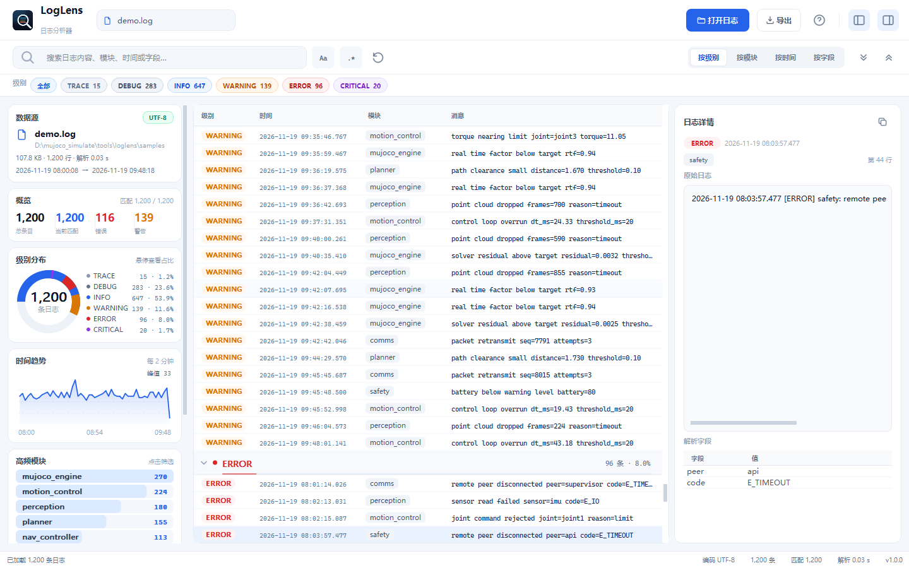
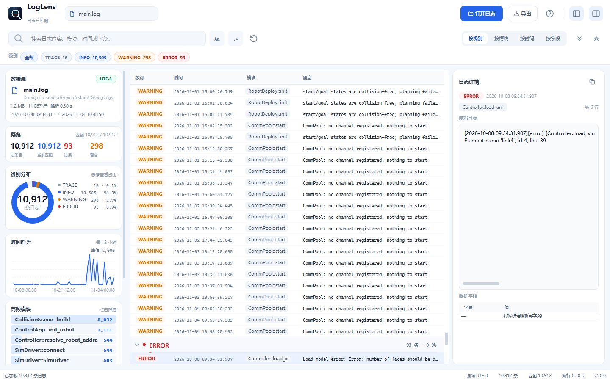
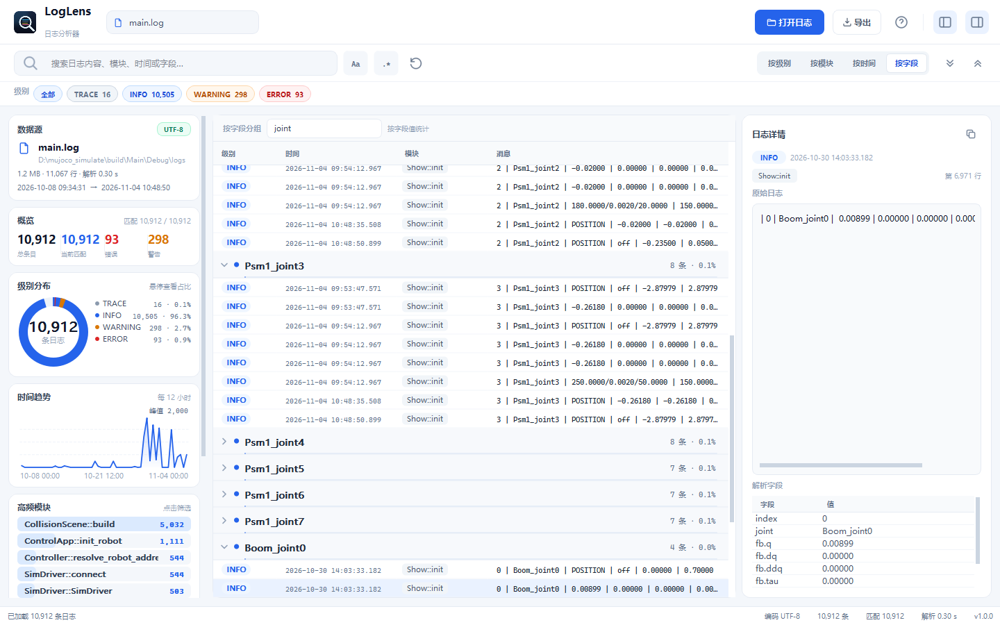

# LogLens 日志分析器

一款轻量、现代的桌面日志分析工具：拖入日志即可自动识别编码、解析结构、按级别 / 模块 / 时间 / 关键字段分类，并提供统计图表、关键词高亮、正则过滤与多格式导出。全部解析都在本机完成，不依赖网络服务。



## 功能特性

- **拖拽导入**：把任意文本日志拖到窗口任意位置，出现深色遮罩后松开即可；自动完成路径识别、编码检测与内容加载。也支持 `Ctrl+O` 或文件选择对话框。
- **自动编码检测**：BOM、UTF-8、UTF-16 LE/BE、GB18030/GBK/GB2312、Big5、Shift-JIS、Windows-1252 / Latin-1；可选 `chardet` 增强识别。
- **结构化解析**：自动提取时间戳、级别、模块、消息与 `key=value` 字段；堆栈、异常等续行会归并到上一条日志；支持项目 `main.log` 的 ASCII 表格块，自动解析成 `index / joint / mode / fb.q` 等字段。
- **特化格式化字段**：识别 `tclog/formatters.hpp` 中 Eigen 矩阵/向量、Eigen Transform、`std::vector`、`Span` 的逗号序列输出（单行或多行矩阵），提取为 `tf`、`q`、`pos`、`vel`、`goal` 等字段。
- **项目日志适配**：原生支持 `[2026-10-08 09:34:31.825][info] [Controller::load_xml] ...` 与 `+---+-----+` / `| # | joint | ... |` 表格；表格行继承上一条日志的时间、级别和模块，可按 `joint` 等字段分组。
- **codeit 指令解析**：`server parse cmd 8115 : {A||B --k=v||...}` 按 `||` 拆分 model，生成 `cmd_id`、`model_count`、`m0.cmd`、`m3.mode_id` 等字段，数组参数（如 `--vel={0,0.02,0,0,0,0}`）保留为逗号分隔文本。
- **多维度分类**：
  - 按级别：TRACE / DEBUG / INFO / WARNING / ERROR / CRITICAL / OTHER；
  - 按模块；
  - 按时间区间自动聚合；
  - 按关键字段的值分组（可选择字段，左侧关键字段双击直达）。
- **分类展示**：可折叠 / 展开的分组、级别颜色标识、数量与占比、分组占比条；单组懒加载，避免超大日志卡顿。
- **统计面板**：总条目 / 匹配 / 错误 / 警告概览，级别占比环图（悬停查看百分比），时间趋势折线（悬停查看区间数量），高频模块点击筛选，关键字段 Top 列表。
- **搜索与高亮**：关键词 / 正则搜索，区分大小写，匹配区间在列表中用琥珀色高亮，详情面板同步高亮。
- **时间筛选**：点击筛选栏的“时间”按钮，在弹窗中选择起止日期和时间，仅显示该时间段内的日志；侧栏“数据源”、时间按钮提示和筛选弹窗都会显示**整个文件的完整时间跨度**；若所选范围早于已加载窗口，会自动按该时间段重新读取文件；可与关键词、级别、模块条件叠加。
- **上下文窗口**：双击任意日志弹出独立窗口，默认显示前后 30 秒，右上角可调 1–3600 秒；按时间正序平铺展示完整原文，目标日志黄色高亮，支持复制全部；可切换“文本”模式直接查看原始日志文本。
- **详情面板**：查看完整原始日志、堆栈、解析字段；矩阵字段按 n×n 展开显示，向量 / `double*` 序列自动换行；一键复制原始内容；面板可显示 / 隐藏。
- **结果导出**：CSV（带 BOM，方便 Excel）、JSON、JSON Lines、原始文本；导出的是**全部筛选结果**，不受列表渲染上限影响。
- **自适应界面**：窗口自由缩放；窄窗口自动隐藏时间 / 模块列；统计与详情面板可独立收起；高 DPI 屏幕下使用逻辑像素字号，避免文字溢出。
- **大文件保护**：后台线程解析、进度显示、可取消；100 MB 以上加载前确认；较大的日志直接从文件末尾定位并解析最近 300,000 条，不再从文件头读完整份文件；同时保留整个文件的完整时间跨度；若所选时间范围不在已加载窗口内，会自动按该区间重新读取文件；单条超长内容截断保护。

## 环境要求

- Windows 10 / 11（主要验证环境）
- Python 3.10+
- PyQt5 5.15+
- 可选：`chardet`（更准确的编码探测）
- 打包 / 重新生成图标：`pyinstaller`、`pillow`

安装运行依赖：

```bash
python -m pip install PyQt5 chardet
```

## 启动

在 `tools/loglens` 目录运行：

```bash
python main.py
```

也可以直接传入日志文件：

```bash
python main.py samples/demo.log
python main.py samples/project_style.log
python main.py D:\mujoco_simulate\build\Main\Debug\logs\main.log
```

如果日志被企业加密软件透明加密，或双击 exe 读不到明文，可双击：

```text
run_loglens.pyw
```

也可以显式使用受信任的解释器：

```bash
pythonw.exe run_loglens.pyw D:\mujoco_simulate\build\Main\Debug\logs\main.log
```

它会以 `pythonw.exe` 启动同一套代码，不显示控制台；也可以直接用 `python main.py path\to\main.log` 运行。

打包后可双击 `dist/LogLens.exe`（单文件，可直接拷到其他 64 位 Windows 10/11 电脑运行）。

## 使用指南

### 1. 导入日志

- **拖拽**：将文件拖到窗口任意区域，界面出现“松开以导入日志文件”遮罩后松开。
- **打开日志**：点击右上角按钮或按 `Ctrl+O`。对话框默认从启动目录（当前工作目录或程序所在目录）开始；打开过文件后默认回到该文件所在目录。
- **编码**：加载后左侧“数据源”卡片会显示检测到的编码；如显示 GB18030，通常对应 GBK/GB2312 文件。
- **多文件**：一次只加载一个文件；拖入多个时自动使用第一个并提示。

> **加密环境（E-SafeNet / 亿赛通等）**
>
> 如果日志文件被企业透明加密，打包后的 `LogLens.exe` 可能只能读到密文。程序会检测 `E-SafeNet` 文件头并给出明确提示。此时可：
> 1. 将 `LogLens.exe` 加入加密软件白名单；
> 2. 使用本项目根目录的 `run_loglens.pyw`（以受信任的 Python 运行）；
> 3. 将日志解密 / 另存为普通文本后导入。
>
> 源码方式（`python main.py ...`）通常运行在受信任的 `python.exe` 下，可以直接读取这类日志。

### 2. 分类视图

工具栏右侧提供四种视图：

| 视图 | 说明 |
|------|------|
| 按级别 | 固定顺序展示 TRACE → CRITICAL、OTHER；不同级别使用不同颜色 |
| 按模块 | 按模块名分组，数量从高到低 |
| 按时间 | 根据时间跨度自动选择秒 / 分钟 / 小时 / 天聚合 |
| 按字段 | 在树顶下拉框选择字段，按字段值分组；无该字段的日志归入“（无该字段）” |

- 点击分组标题可折叠 / 展开；工具栏右侧按钮可全部展开 / 折叠。
- 点击左侧“关键字段”中的任意字段（双击）可直接切换到该字段的按值分组视图。
- 级别标签行为：全部选中时点击某个级别 = 只看该级别；再次点击同一级别 = 恢复全部；“全部”按钮随时重置。

### 3. 搜索与筛选

- 搜索范围包含原始日志、模块、时间与级别文本。
- `Aa`：区分大小写；`.*`：使用正则表达式。
- 无效正则会显示红色边框并在状态栏提示，不会破坏当前结果。
- **时间筛选**：点击筛选栏的“时间”按钮打开时间范围弹窗，分别选择起始和结束日期、时间；日期可用日历选择，时间可直接输入或用上下箭头调整。应用后只显示该区间内的日志，结束秒内带毫秒的日志也会包含；无时间戳的日志会被排除。侧栏“数据源”、时间按钮悬停提示与筛选弹窗都会显示整个文件的完整时间跨度，便于定位。如果所选范围早于已加载窗口，会自动按该时间段重新读取文件。再次点击“时间”可修改范围，弹窗中的“清除筛选”可恢复最近 300,000 条。
- **上下文窗口**：双击任意日志行弹出独立窗口，显示该条前后指定跨度的日志；右上角“前后跨度”支持 1–3600 秒，默认 30 秒。窗口按时间正序平铺（不按级别分组），每条展示完整原始内容（多行堆栈、矩阵原样显示），目标日志黄色高亮并自动滚动到中间；点击右上角“文本”可切换为直接展示原始日志文本；顶部显示条数与时间范围，底部可“复制全部”。数据来自全部已加载日志，不受当前级别 / 模块 / 搜索筛选影响；紧邻时间段的无时间戳日志也会一并展示。
- 搜索框右侧的 `×` 清除搜索；`Ctrl+L` 重置搜索、级别、模块与时间筛选。

示例：

```text
timeout
battery=\d+
(ERROR|CRITICAL).*failed
```

### 4. 查看详情

- 单击日志行，在右侧详情面板查看时间、级别、模块、行号、完整原始日志与解析字段。
- 解析字段中的矩阵按 n×n 多行展示（如 `endtf · 4×4`），向量与 `double*` 序列按列宽自动换行。
- 双击日志行可确保详情面板展开。
- 详情面板右上角复制按钮或列表右键菜单可复制原始日志 / 消息。
- 详情面板顶部时间来自日志自身；JSON / 带时区时间会转换为本地时间显示。

### 5. 导出结果

点击“导出”或按 `Ctrl+E`：

| 格式 | 内容 |
|------|------|
| CSV | 行号、时间、级别、模块、消息、字段 JSON、原始内容；UTF-8 BOM，Excel 可直接打开 |
| JSON | 记录数组，适合脚本处理 |
| JSON Lines | 每行一条 JSON，适合流式处理 |
| 文本 | 原始日志内容，保留堆栈 |

导出始终包含**全部当前筛选结果**；列表为了性能默认只渲染每组最近的 1,000 条，点击分组顶部提示可继续加载更早记录。

### 6. 大文件与保护策略

- 超过 **100 MB** 会弹出确认；解析在后台线程进行，可随时取消。
- 文件大小上限 **1 GB**。较大的日志会从文件末尾按行倒推起点，只解析覆盖最近 **300,000** 条所需的窗口，避免读完整个文件后丢弃早期记录；行号与总行数仍按整个文件计算。
- 解析尾部窗口时会额外读取文件头尾，侧栏显示**整个文件的完整时间跨度**，时间按钮提示与筛选弹窗也使用该跨度，确保时间筛选能定位到任意时间段。
- 如果时间筛选选择的范围早于已加载窗口，程序会自动按该时间段重新读取文件，只显示该范围内的日志；清除时间筛选后恢复最近 **300,000** 条。日志时间戳基本有序时，时间范围解析会在越过结束时间后提前收尾。
- 单条日志（含堆栈）超过 **128 KB** 会截断，并在结果中标记。
- 每个分组默认渲染最近 **1,000** 条（优先看到最新日志），点击分组顶部提示可继续加载更早记录；分组计数、统计与导出仍基于全部匹配记录。
- 交互式过滤在 100,000 条日志下通常低于 0.1 秒；300,000 条仍可流畅使用搜索缩小范围。

## 支持的日志格式

| 格式 | 示例 |
|------|------|
| 中括号常见格式 | `2026-11-19 09:14:03.128 [INFO] nav_controller: robot pose updated x=1.2` |
| Python logging | `2026-11-19 09:14:04,200 - perception - WARNING - frame dropped` |
| 级别前置 | `2026-11-19 09:14:05.301 ERROR [planner] trajectory failed reason="collision"` |
| Spring Boot | `2026-11-19 09:14:03.123  INFO 1234 --- [main] c.f.NavService : started` |
| ISO / UTC | `2026-11-19T09:14:06.400Z INFO comms - heartbeat ok` |
| syslog | `Nov 19 09:14:03 host app[123]: service started` |
| glog | `I1119 09:14:03.123456 1234 nav.cc:88] pose updated` |
| Android Logcat | `11-19 09:14:03.123 1234 5678 E ActivityManager: crash detected` |
| JSON Lines | `{"timestamp":"...","level":"warn","logger":"gateway","message":"slow request","latency_ms":345}` |
| 项目 main.log | `[2026-10-08 09:34:31.825][info] [Controller::load_xml] message` + ASCII 表格 |
| 项目 LOUT | `[2026-09-21 20:06:32.763] [codeit] server parse cmd ...`、`[warn][/path/a.cpp:268] message`、`[instrument][info] message` |
| 纯文本 | 无结构行会按 `error / failed / warn` 等关键词推断级别，否则归入 OTHER |

时间戳支持 `YYYY-MM-DD HH:MM:SS[.mmm]`、ISO8601 带时区、`YYYY/MM/DD`、syslog、epoch 秒 / 毫秒、纯时间等；堆栈续行支持 Python traceback、Java `at ...` / `Caused by:` 等。

### 项目 `main.log` 实测

`build/Main/Debug/logs/main.log` 这类格式包含：

- 带级别与模块前缀的日志行：
  `[2026-10-08 09:34:31.907][error] [Controller::load_xml] Load model error: ...`
- `Show::init` 打印的 ASCII 关节表：
  ```
  +---+-------------+----------+-------+------------+------------+
  | # | joint       | mode     | ladrc | lower[rad] | upper[rad] |
  +---+-------------+----------+-------+------------+------------+
  | 1 | Psm1_joint1 | POSITION | off   |   -0.05000 |    0.35000 |
  +---+-------------+----------+-------+------------+------------+
  ```
- 无时间戳的多行错误详情、`Joint Angles` 关节角块、OMPL 规划详情。

LogLens 会把每个表格数据行解析为一条日志，继承表格前一条日志的时间、级别与模块，并生成 `index`、`joint`、`mode`、`ladrc`、`lower[rad]`、`upper[rad]`、`fb.q`、`table` 等字段。随后：

1. 在“按模块”中查看 `Show::init`、`CollisionScene::build` 等模块；
2. 在“按字段”中选择 `joint`，即可按关节分组查看限制表 / 反馈表；
3. 选中表格行，右侧“解析字段”展示完整列值；
4. 使用 `ERROR` 标签或搜索 `Load model error` 定位错误，多行 `Element name ...` 会保留在错误详情中。

### codeit 指令（LOUT）

LOUT 中的 `server parse cmd <id> : {A||B --k=v||...}` 会按 `||` 拆分成 model（索引从 0 开始）：

```text
[2026-09-21 20:06:32.763] [codeit] server parse cmd 8115 : {PushStatus||PushStatus --mode_id=3 --master_map_id=3 --master_5G_id=7||PushStatus||PushStatus --mode_id=5 --master_map_id=5 --master_5G_id=8||PushStatus}
```

- 生成 `cmd_id=8115`、`model_count=7`；
- 每个 model 生成 `m0.cmd`、`m1.cmd`……以及参数 `m1.mode_id=3`、`m3.master_5G_id=7` 等字段；
- `--vel={0,0.02,0,0,0,0}` 这类数组参数会去掉外层花括号并规范为 `0,0.02,0,0,0,0`；
- 这些字段可搜索、在“按字段”中分组，并随 CSV / JSON 导出。

### tclog 特化格式化字段

针对 [formatters.hpp](../../tclog/include/tclog/formatters.hpp) 中的 fmt 特化，LogLens 会把以下输出解析成字段：

```text
[info] [Controller] q=0.1, 0.2, 0.3                  → q = "0.1,0.2,0.3"
[info] [Command] param:goal=0,0,0,0,0,0              → param:goal = "0,0,0,0,0,0"
[info] [Math] tf:                                    → tf = 16 个数值
1.000, 0.000, 0.000, 0.500,
0.000, 1.000, 0.000, 0.600,
0.000, 0.000, 1.000, 0.700,
0.000, 0.000, 0.000, 1.000
```

- 支持 Eigen 矩阵 / 向量、Eigen Transform（4x4）、`std::vector<T>`、`Span<T>`；
- 支持单行逗号序列、跨行矩阵（行尾 `,\n`）、括号包裹的序列、负数和科学计数法；
- 提取出的字段可搜索、在详情中查看、随 CSV/JSON 导出，并可参与“按字段”分组；
- 多行矩阵的后续数值行会自动归并为同一条日志，不会产生额外的 OTHER 条目。

实测 11,067 行 / 1.2 MB 的 `main.log`：10,912 条日志、77 条表格行、0 条未识别，WARNING 298 条、ERROR 93 条、TRACE 16 条；解析约 0.3 秒，界面加载约 1 秒。真实日志中的 `tcp`、`pos`、`vel`、`acc`、`lim`、`param:goal`、`pid` 等序列也已成功提取为字段。





示例文件：[samples/project_style.log](samples/project_style.log)。

## 快捷键

| 快捷键 | 功能 |
|--------|------|
| `Ctrl + O` | 打开日志文件 |
| `Ctrl + E` | 导出当前筛选结果 |
| `Ctrl + F` | 聚焦搜索框 |
| `Ctrl + L` | 重置搜索与筛选 |
| `Ctrl + Shift + E` | 全部展开 |
| `Ctrl + Shift + W` | 全部折叠 |
| `Ctrl + C` | 在日志列表聚焦时复制选中行原始日志 |
| `F1` | 打开内置使用说明 |
| `Esc` | 搜索框聚焦时清空搜索 |

## 自动化测试

在 `tools/loglens` 目录执行：

```bash
python -m unittest discover -s tests -v
```

共 **119** 项测试，覆盖：

- 编码检测：UTF-8 / UTF-8 BOM / GBK / UTF-16（含无 BOM）/ Latin-1；
- 解析准确性：log4j / Python logging / Spring Boot / syslog / glog / Logcat / JSON Lines / 纯文本 / 堆栈归并；
- 项目格式：`[时间][级别] [模块]`、ASCII 关节表、无时间戳多行块、`param:angle=...` 字段、LOUT 方括号标签 / 源码位置 / 多行数值块 / codeit model 参数、E-SafeNet 加密头识别；
- 特化格式：Eigen / Transform / std::vector / Span 的单行序列、跨行矩阵、括号序列、负数与科学计数法；
- 打开日志对话框的默认启动目录；
- 边界与稳定性：空文件、二进制拒绝、异常行、条目上限、取消、进度、尾部窗口解析、完整时间跨度探测、时间范围提前收尾；
- 筛选与统计：关键词、正则、大小写、级别、模块、时间范围、字段分组、时间分桶、字段统计；
- 导出：CSV / JSON / JSONL / TXT；
- UI：拖拽导入、分组折叠、级别隔离、搜索高亮、详情、模块筛选、字段分组、项目表格行、空状态、导出、面板开关、上下文窗口；
- 展示与分页：矩阵 n×n 展开、向量换行、分组行整行铺满、分组优先渲染最新记录、点击提示加载更早记录；
- 自适应：1024×768、1440×900、1920×1080 下的列隐藏与分栏尺寸；
- 性能回归：1,000 / 25,000 / 100,000 行文件解析与筛选。

> UI 测试会短暂创建真实窗口。Qt 的 `offscreen` 平台在部分 Windows 环境没有字体数据库，控件尺寸不可靠，因此 UI 测试使用默认 Windows 平台；如只需核验解析内核，可运行：
>
> ```bash
> python -m unittest tests.test_parser tests.test_analysis tests.test_performance -v
> ```

参考结果（开发机，Python 3.14 / PyQt5 5.15，受磁盘透明加密与杀毒环境影响会有波动）：

- 100,000 行解析约 **2–6 s**（约 30,000–50,000 行/秒）；
- 100,000 行关键词 + 级别筛选约 **0.02–0.04 s**，汇总约 **0.01–0.03 s**；
- 项目 `main.log` 11,067 行：解析约 **0.3 s**，UI 完整加载约 **1–2 s**。

## 生成可执行程序（PyInstaller + spec）

在本目录执行：

```bash
python -m pip install pyinstaller pillow PyQt5 chardet
python -m PyInstaller --noconfirm --clean LogLens.spec
```

输出：

```text
dist/LogLens.exe
```

说明：

- `LogLens.spec` 使用 **onefile** 模式，产物是单个 `dist/LogLens.exe`，可直接拷贝到其他 64 位 Windows 10/11 电脑运行，无需安装 Python / PyQt5。
- 首次启动会把运行依赖解压到系统临时目录，启动速度比源码方式稍慢；请勿把 exe 放在只读目录中运行。
- 窗口模式（`console=False`），自动捆绑应用图标、截图、示例日志与 README。
- 已排除 tkinter、matplotlib、numpy、pandas 等未使用依赖，减小体积。
- 若未安装 `chardet`，请从 spec 的 `hiddenimports` 中移除后重新打包；程序仍可通过内置探测工作。
- **加密环境限制**：E-SafeNet 等透明加密按进程白名单解密。未加入白名单的 `LogLens.exe` 只能读到密文，程序会提示应加入白名单或改用 `run_loglens.pyw`。

### 重新生成图标

```bash
python assets/make_icon.py
```

使用 Pillow 以 1024 px 超采样绘制“放大镜 + 彩色日志行”图标，并输出：

- `assets/loglens.png`：窗口 / 页面 Logo；
- `assets/loglens.ico`：多尺寸（16–256 px）exe 与任务栏图标。

## 目录结构

```text
tools/loglens/
├── main.py                  # 启动入口
├── loglens/
│   ├── parser.py            # 编码检测、流式解析、堆栈归并、大文件保护
│   ├── analysis.py          # 搜索过滤、统计、时间分桶、分组、导出
│   ├── theme.py             # 颜色、字体与全局 QSS
│   ├── icons.py             # 内置线性图标与 Logo 加载
│   ├── widgets.py           # 图表、日志树、详情、拖拽遮罩、筛选栏等
│   └── main_window.py       # 主窗口、后台加载、交互与快捷键
├── assets/
│   ├── loglens.ico          # 应用图标（多尺寸）
│   ├── loglens.png          # Logo
│   ├── screenshot.png       # 通用示例截图
│   ├── screenshot_project.png       # 项目 main.log 截图
│   ├── screenshot_project_field.png # 按 joint 字段分组截图
│   └── make_icon.py         # 图标生成脚本
├── samples/
│   ├── demo.log             # 1,200 条 UTF-8 演示日志
│   ├── demo_gbk.log         # GBK 中文演示日志
│   ├── project_style.log    # 项目 main.log 同格式示例（含 ASCII 表格）
│   └── LOUT                 # 项目 LOUT 实测日志（方括号标签格式）
├── tests/
│   ├── test_parser.py       # 编码、格式、项目表格、加密头
│   ├── test_analysis.py     # 搜索、统计、分组、导出
│   ├── test_ui.py           # PyQt5 交互与响应式
│   └── test_performance.py  # 规模与性能
├── run_loglens.pyw          # 加密环境下的 Python 启动器
├── LogLens.spec             # PyInstaller 打包配置
└── README.md
```

## 实现要点

- **解析核心无 GUI 依赖**，可单独用于脚本或二次开发。
- **流式解析**：逐行读取，采样检测编码，按需停止；不会一次性把整个大文件读入内存。
- **分类模型**：级别、模块、时间桶、字段值均为统一 `LogGroup`，UI 只负责渲染，便于扩展新维度。
- **图表自绘**：环图、趋势图、模块条形图均用 `QPainter` 实现，不依赖 matplotlib，打包体积更小。
- **高 DPI**：自定义绘制使用像素字号并按 Qt 逻辑像素换算，避免 200% 缩放下文字过大导致列截断。
- **响应式**：窗口变窄时隐藏时间 / 模块列，筛选标签自动换行，统计与详情面板可独立折叠。

## 常见问题

**拖拽没有反应**
部分远程桌面、虚拟机或权限受限环境会拦截 Explorer 拖拽，此时点击“打开日志”选择文件即可。

**中文显示乱码**
工具会自动检测常见中文编码。若文件混合了多种编码，建议先用编辑器另存为 UTF-8；GBK 文件显示为 GB18030 属于正常现象。

**日志被 E-SafeNet / 加密软件保护，exe 读不到内容**
程序会提示“文件似乎被 E-SafeNet 透明加密”。这是企业 DLP 的进程白名单机制，不是解析失败。可任选：
1. 让 IT 把 `LogLens.exe` 加入加密软件白名单；
2. 在 `tools/loglens` 下双击 `run_loglens.pyw`（以受信任的 `pythonw.exe` 运行）；
3. 在终端运行 `python main.py build\Main\Debug\logs\main.log`；
4. 将日志解密 / 导出为普通文本后再导入。

**项目 main.log 里的表格为什么按 INFO 显示？**
`+---+` / `| # | joint | ... |` 表格行没有自己的时间戳和级别，工具会继承表格前一条日志（通常是 `Show::init`）的时间、级别和模块，并把列解析成字段。使用“按字段 → joint”即可按关节查看这些数据。

**大文件加载较慢 / 只显示部分日志**
超过 100 MB 会先确认；较大的日志会从文件末尾只解析最近 300,000 条所需窗口，但仍会显示整个文件的完整时间跨度。每组默认渲染最近 1,000 条，可点击提示继续加载更早记录。若时间筛选的范围早于已加载窗口，会自动按该时间段重新读取文件并只显示该范围；清除时间筛选恢复最近 300,000 条。使用搜索、级别筛选或导出查看全部匹配结果。

**导出的条数比列表多**
列表为了流畅度默认只渲染每组最近的 1,000 条，点击顶部提示可加载更早记录；导出和分组计数使用全部筛选结果。

**Windows 提示未知发布者**
PyInstaller 生成的 exe 未签名，属于正常提示；正式分发可使用代码签名证书。

**高 DPI 下界面大小变化**
程序已启用 Qt 高 DPI 缩放；如修改系统缩放比例，重启应用后生效。
